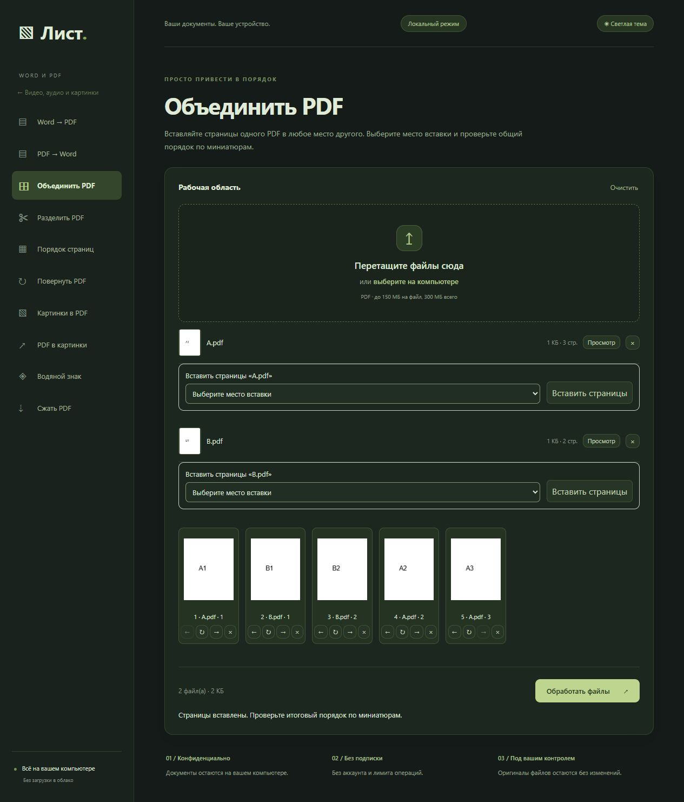

# Лист

Локальный конвертер для документов, книг, изображений, видео и аудио. Соберите PDF из нескольких файлов, сделайте EPUB из книги или извлеките звук из видео. Интерфейс открывается в браузере, обработка идёт на вашем компьютере.

| Сборка | Скачать | Что понадобится |
| --- | --- | --- |
| Windows 10 и 11 (x64) | **[Скачать ZIP · v0.1.0-beta.2](https://github.com/l1qu1dd/list-converter/releases/download/v0.1.0-beta.2/list-windows-x64-v0.1.0-beta.2.zip)** · около 1 ГБ | Microsoft Edge или Google Chrome. Движки уже в ZIP. |
| macOS | **[Тестовая сборка](https://github.com/l1qu1dd/list-converter/releases/tag/v0.1.0-macos-preview.1)** | Homebrew. Запуск на Mac ещё предстоит проверить. |

[Все выпуски и контрольные суммы](https://github.com/l1qu1dd/list-converter/releases)

## Что умеет «Лист»

- **PDF и Word.** Объединяйте и делите PDF, вставляйте страницы одного файла в середину другого, меняйте их порядок. Превращайте DOCX в PDF, а PDF с текстовым слоем — в редактируемый Word. Для сканов есть распознавание русского и английского текста.
- **Электронные книги.** Конвертируйте EPUB, FB2, MOBI, AZW3 и другие форматы. Для PDF → EPUB можно выбрать подстраиваемый текст или сохранить вид исходных страниц.
- **Изображения.** Меняйте формат, размер и поворот. Для подходящих форматов можно перенести метаданные снимка и отдельно выбрать, сохранять ли координаты.
- **Видео и аудио.** Меняйте формат ролика, отделяйте звук, сохраняйте кадр или делайте GIF. Для YouTube есть скачивание отдельного видео по ссылке.
- **Markdown.** Подготовьте Markdown из документа или книги. Из Markdown можно получить Word или PDF.

Можно увеличить страницы и картинки в предпросмотре, поставить несколько файлов в очередь и скачать готовые результаты одним ZIP.

## Как запустить

### Windows

1. Скачайте ZIP по ссылке выше. Нажмите **«Извлечь всё»** и откройте распакованную папку `pdf-workshop`.
2. Запустите **`Запустить.cmd`**. Откроется отдельное окно «Листа». Закрытие этого окна или чёрного окна запуска завершает работу приложения.

Node.js, FFmpeg и LM Studio отдельно устанавливать не нужно. Чтобы обновиться, закройте «Лист» и распакуйте свежий ZIP в новую папку.

### macOS

Распакуйте тестовый ZIP и откройте `README-macOS.md`. Там перечислены компоненты для установки через Homebrew и шаги запуска `Запустить.command`.

## Частые вопросы

**Куда попадают мои файлы?** Локальные конвертации выполняются на вашем компьютере. Рабочие копии остаются в текущем сеансе и очищаются после скачивания результата или завершения сеанса. Исходники и скачанные файлы сохраняются.

**Сохранится ли вёрстка PDF в EPUB?** Выберите режим сохранения страниц, если важен внешний вид. Для чтения на маленьком экране можно выбрать подстраиваемый текст и проверить в результате таблицы, формулы и порядок чтения.

**Почему YouTube может не скачиваться?** Требуется интернет. В зависимости от ролика и подключения YouTube может запросить вход или вернуть сетевую ошибку. Это ограничение относится к скачиванию по ссылке.

## Как сообщить об ошибке

Напишите в Telegram. Укажите версию «Листа», систему, исходный и выходной форматы, шаги и точный текст ошибки. Если нужен пример файла, приложите обезличенную копию. [@user_liquidd](https://t.me/user_liquidd).

[Сторонние компоненты и исходный код](THIRD_PARTY.md)
